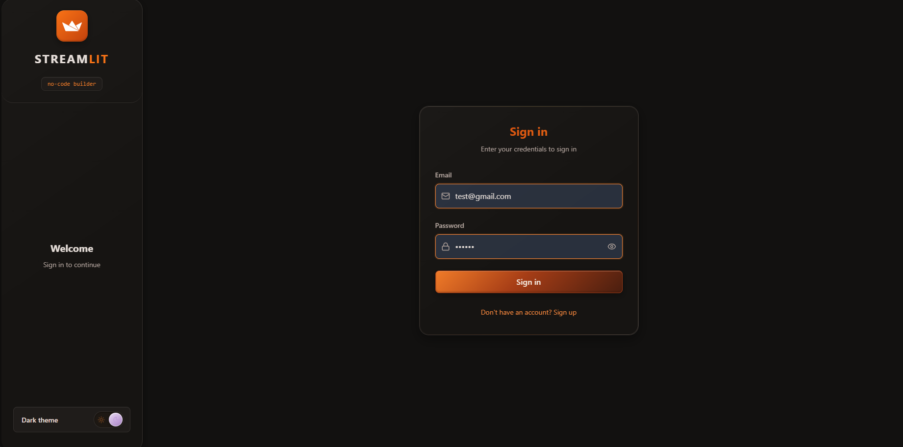
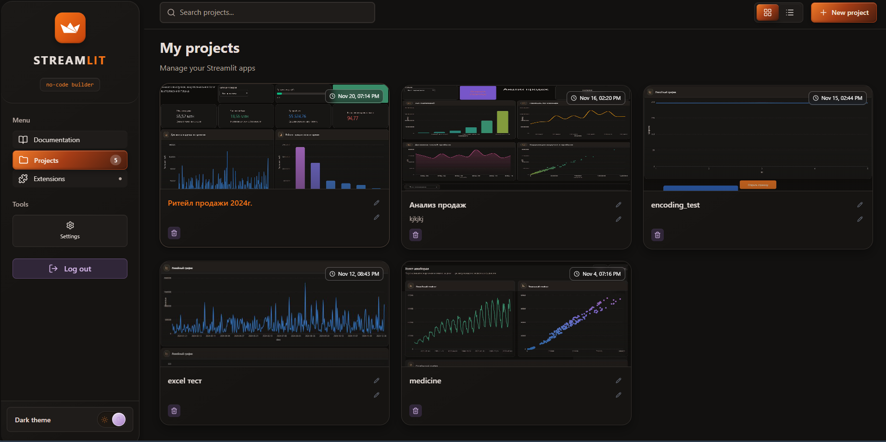
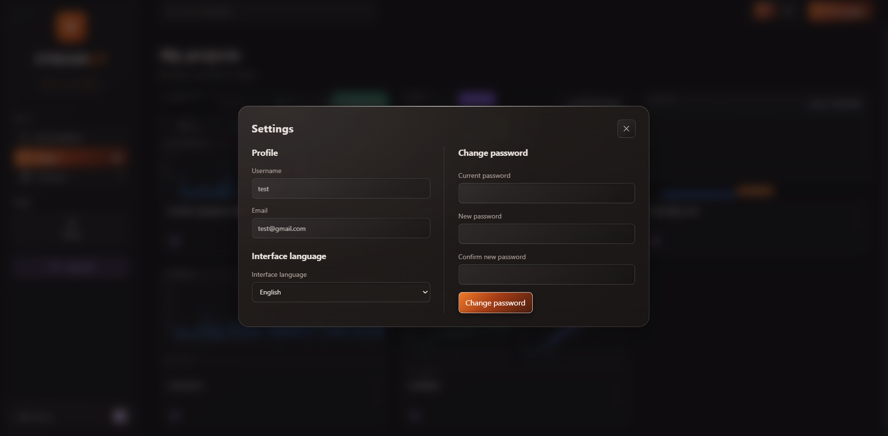
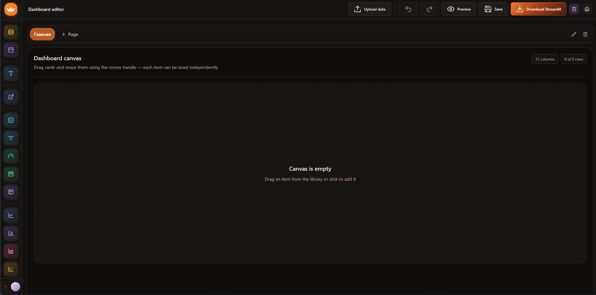
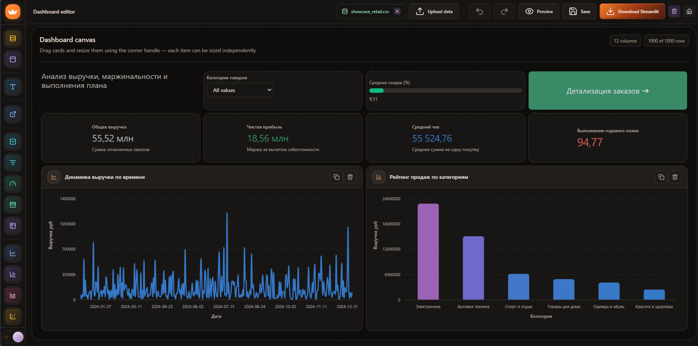
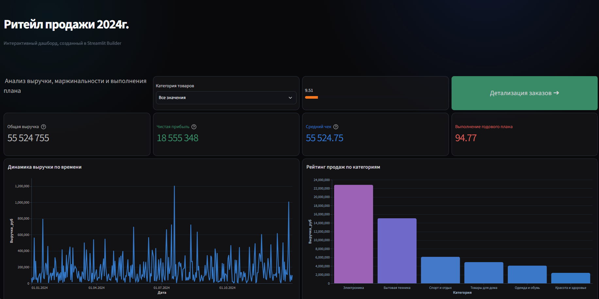

**English** | [Русский](README.ru.md)

# Streamlit App Builder (No-Code Dashboard Builder)


**A visual no-code builder for quickly creating interactive dashboards powered by Python and Streamlit.**

**Use case:** upload a data table (`CSV`, `TSV`, or `Excel`), drag and drop charts, KPI metrics, tables, and filters onto the canvas, and get a ready-to-run web application without writing a single line of code. Designed for data analysts, product managers, and developers who want to build a working prototype or full dashboard without manual layout coding.

### How It Works & What You Get
1. **Upload data:** upload one or multiple data sources and immediately bind their columns on the canvas.
2. **Fast visual assembly on the canvas:** drag components onto a 12-column grid, customize colors, aggregations, and build multi-page dashboards. Charts on the canvas are rendered directly in your browser using the **Recharts** library for instant feedback while editing.
3. **Preview in Streamlit:** to see how the final app and its generated Python code actually look and behave on the **Streamlit** engine, launch the preview — your dashboard opens in an embedded modal or a separate browser tab before you download anything.
4. **One-click source code export:** download a standalone ZIP archive (`app.py`, datasets, `requirements.txt`, and local run scripts). You are not locked into the platform — deploy the code on any server or extend it manually in Python.

> **About this repository:** This repository contains the web editor (React Frontend) and [`docker-compose.yml`](docker-compose.yml) to launch the entire platform. The backend service (API, project storage, Streamlit preview runner, and Python code generator) is maintained in [`streamlit_project_backend`](https://github.com/AlexFeed/streamlit_project_backend).

---

## Positioning

This project is **not a direct competitor to enterprise BI platforms** such as Apache Superset, Yandex DataLens, Metabase, or Power BI. It addresses a different goal: **rapidly building standalone Python and Streamlit dashboards with complete freedom over how you use the output**.

* **No vendor lock-in:** in traditional BI tools, dashboards live inside the platform and cannot be moved without running that BI server. Here, the builder is only used during creation — the exported project is completely independent of our service.
* **Plain Python code as output:** instead of proprietary configuration files, you get clean Streamlit code (`app.py`), a `requirements.txt` dependency list, and your datasets.
* **Freedom to customize and integrate:** run the downloaded dashboard on any computer or server, push it to Git, extend it with custom Python logic (ML models, scrapers, APIs), or embed it as a page or module inside an existing Python or Streamlit application.
* **Quick start without heavy infrastructure:** no need to deploy and maintain a complex BI stack just to ship a team report, internal tool, or analytical prototype.

---

## Platform Interface

### Sign In & Project Management

*Sign-in and registration page.*


*Home page displaying saved projects.*


*Application settings page.*

### Builder & Preview

*Empty project in the editor: component palette on the left, 12-column grid in the center, and properties panel on the right.*


*Assembled dashboard in the builder with configured charts and filters (browser preview rendered via Recharts).*


*The same application running on the Streamlit engine via the preview window.*

---

## Getting Started

### Option 1. Run with Docker

This method launches the entire platform (web editor, backend server, and built-in Streamlit preview) — no need to clone the source code or install Python or Node.js manually. All you need is [`docker-compose.yml`](docker-compose.yml): Docker will pull the prebuilt images and start every service automatically.

**Requirements:** [Docker Desktop](https://www.docker.com/products/docker-desktop/) (or Docker Engine + Docker Compose) and free ports `5173`, `8000`, and `8501`.

1. Create a folder and download [`docker-compose.yml`](docker-compose.yml) into it (either via the *Download raw file* button on GitHub or from your terminal):
   * **Linux / macOS / Git Bash:**
     ```bash
     mkdir streamlit-builder && cd streamlit-builder
     curl -fsSLO https://raw.githubusercontent.com/AlexFeed/streamlit_project/main/docker-compose.yml
     ```
   * **Windows (PowerShell):**
     ```powershell
     mkdir streamlit-builder; cd streamlit-builder
     Invoke-WebRequest -Uri https://raw.githubusercontent.com/AlexFeed/streamlit_project/main/docker-compose.yml -OutFile docker-compose.yml
     ```
2. In the folder containing `docker-compose.yml`, start the platform in the background (on the first run, Docker will pull the images and start the services — this may take 1–2 minutes):
   ```bash
   docker compose up -d
   ```
3. Open the builder in your browser:
   * **Web Editor:** http://localhost:5173

**First launch in your browser:** register a new local account on the sign-in screen — accounts, projects, and uploaded files are persisted locally in the `streamlit_storage` Docker volume. Once signed in, create a project and upload a `CSV`, `TSV`, or `Excel` file.

<details>
<summary>Container management (stop, update, logs)</summary>

* **Stop containers** *(your accounts, projects, and datasets are preserved in `streamlit_storage`)*:
  ```bash
  docker compose down
  ```
* **Update to the latest images:**
  ```bash
  docker compose pull && docker compose up -d
  ```
* **View logs:**
  ```bash
  docker compose logs -f
  ```
* **Remove containers together with all local data:**
  ```bash
  docker compose down -v
  ```

</details>

---

### Option 2. Local Development from Source

Suitable for developers who want to run and modify the frontend UI locally.

> **Important:** the frontend handles only the visual interface. For authentication, file uploads, saving projects, Streamlit preview, and ZIP archive generation, **you must also run the backend server** from [`streamlit_project_backend`](https://github.com/AlexFeed/streamlit_project_backend) (see its `README.md` for setup and launch instructions).

**Requirements:** Node.js 20+ and a running backend server.

1. Clone the repository and enter the project directory:
   ```bash
   git clone https://github.com/AlexFeed/streamlit_project.git
   cd streamlit_project
   ```
2. Install dependencies:
   ```bash
   npm install
   ```
3. Start the dev server:
   ```bash
   npm run dev
   ```

By default, the editor is available at http://localhost:5173 and connects to the API at `http://localhost:8000`. If your backend runs on a different host or port, set `VITE_API_BASE_URL` before starting:
* **Linux / macOS / Git Bash:**
  ```bash
  VITE_API_BASE_URL=http://localhost:8000 npm run dev
  ```
* **Windows (PowerShell):**
  ```powershell
  $env:VITE_API_BASE_URL="http://localhost:8000"; npm run dev
  ```

---

## Current Features

### Visual Editor & Layout
* **12-column canvas:** drag components from the palette or click to add them, freely resize card width and height, duplicate elements, and use **Undo / Redo** history.
* **Multi-page dashboards:** create multiple pages inside a single project, switch between them in the top editor bar, and configure buttons or text links to navigate across pages.
* **Sections & Tabs:** group components inside **Section** containers with configurable spacing, background, borders, and alignment, or organize multiple content areas inside **Tabs** on a single page.
* **Fast canvas rendering (via Recharts):** while editing, charts, tables, and metrics are rendered directly in your browser using **Recharts** (on a sample of up to 1,000 rows for high responsiveness). This serves as a fast interactive draft for layout and field binding; its styling may differ slightly from the final Streamlit output.

### Supported Charts, Elements & Filters
* **Charts:** `Line Chart`, `Bar Chart`, `Area Chart`, and `Scatter Plot`. Supports aggregations (`sum`, `mean`, `count`, `min`, `max`, `none`), sorting along X/Y axes, built-in color palettes (single color, value gradient, categorical coloring), and axis label customization.
* **Data & KPIs:** KPI **Metric** cards, **Progress** bars (with configurable min/max bounds), and **Tables** — either a **Data table** with column selection and row limits (up to 10,000 rows) or a **Pivot table** with grouping and value aggregation.
* **Interactive filters:**
  * Category & value **Filter** (Dropdown, Multiple choice, Radio buttons, Segmented control, Pills).
  * **Range or date** data controls (Numeric range, Date picker, Toggle).
* **Styling & navigation:** **Text** blocks with configurable font size, weight, color, and alignment, plus **Page link** components for multi-page navigation.

### Data Sources
* **Supported formats:** `CSV`, `TSV`, and `Excel` (`.xlsx`, `.xls`).
* **Flexible import:** column delimiter selection (or auto-detection) and support for **24 encodings** (`UTF-8`, `UTF-8 with BOM`, `Windows-1251`, `CP866`, `KOI8-R`, etc.) with auto-detection.
* **Excel sheet inspection:** when uploading a workbook, the editor reads available sheet names and lets you pick the desired sheet before importing.
* **Multiple datasets per project:** upload several tables into one project and bind each chart, table, or filter to its own source.

### Preview, Export & Workspace
* **Real Streamlit App Preview:** click **Preview** to verify how the dashboard looks and behaves in **Streamlit** itself (using the generated Python code and the entire uploaded dataset) inside an embedded modal or a new browser tab — without downloading the archive.
* **Export ready-to-run project:** download a ZIP archive containing the generated `app.py`, your datasets, `requirements.txt`, and local launch scripts (`run_local.bat` / `run_local.sh`; Python is required to run the exported project locally).
* **Account & UI:** user registration and login, project gallery with preview cards, local draft auto-saving, light/dark theme switching, and bilingual interface (**RU / EN**).

---

## Current Limitations (MVP) & Roadmap

The project is currently in MVP stage and is primarily intended for local usage, prototyping, and small teams.

### Current Limitations
* **File-based storage:** accounts, projects, and uploaded files are stored on the server disk (in the `streamlit_storage` Docker volume) without an external database or object storage.
* **No team collaboration or advanced auth:** projects belong to individual accounts — there is no real-time collaboration, role-based access control (RBAC), `refresh_token`, or password reset yet.
* **One dataset per component:** while you can upload multiple tables to a project, joining datasets (`JOIN`) or connecting directly to external databases/APIs is not yet supported in the UI.
* **Basic chart set & prototype extensions:** pie charts (`Pie Chart`) and custom Streamlit app theme builders are not available yet; the **Extensions** page in the UI is currently a showcase prototype and does not inject third-party libraries into the exported code.
* **Shared Streamlit preview process:** the live preview runs on a single background Streamlit process, which works well for individual users or small teams but is not designed for high concurrent load.

### Roadmap
* **Expanded Streamlit charts & interactive widgets:** adding new chart types (such as pie charts) and additional widgets from the Streamlit ecosystem.
* **Richer per-chart configuration:** expanding chart-specific properties and options (additional axis settings, legends, data labels, and visual styling).
* **Built-in code mini-editor before export:** viewing and editing the generated Python code (`app.py`) directly inside an in-app modal before downloading the project.
* **Extensions & custom plugins support:** turning the **Extensions** section into a working plugin system so enabled libraries (such as charts, maps, and custom components) are persisted on the backend and integrated into the editor and exported `app.py` (currently the Extensions page is a static UI demo).
* **New data sources & joins:** connecting external databases/APIs and joining multiple datasets (`JOIN`) inside a dashboard.
* **Custom themes & publishing:** theme customization for exported apps and direct export/publishing of generated dashboards to a Git repository.

---

## Tech Stack & Documentation

* **Frontend:** React 19, Vite 8, React Router v7, GridStack, @dnd-kit, Recharts, Tailwind CSS, Nginx (in the Docker image).
* **Backend & Code Generation:** FastAPI, Pydantic v2, Pandas, Streamlit.
* **Frontend production build:** `npm run build`
* **Detailed backend architecture, REST API, and schema contract:** see [`streamlit_project_backend`](https://github.com/AlexFeed/streamlit_project_backend).

---

## License

Copyright © 2026 Project Authors and Contributors ([Contributors](https://github.com/AlexFeed/streamlit_project/graphs/contributors))

The builder's source code is licensed under the **GNU Affero General Public License v3.0 (`AGPL-3.0-only`)** — see the [`LICENSE`](LICENSE) file for the full text.

* **For builder users:** you may freely use, run, copy, and modify the platform, including inside organizations and to build commercial dashboards. If you modify the builder itself and distribute it or make it available over a network (e.g., as a hosted web service), your version must also be released under `GNU AGPLv3` with copyright notices preserved.
* **Generated Dashboard Exception (Additional Permission, Section 7 AGPLv3):** the `GNU AGPLv3` terms apply **only to the builder's own source code**. Exported dashboards (`app.py` and the contents of the downloaded ZIP archive) are **not** subject to `AGPLv3` copyleft requirements — you are free to run, modify, sell, and embed them into any Python or Streamlit project (including closed-source and commercial applications) without opening your own code.