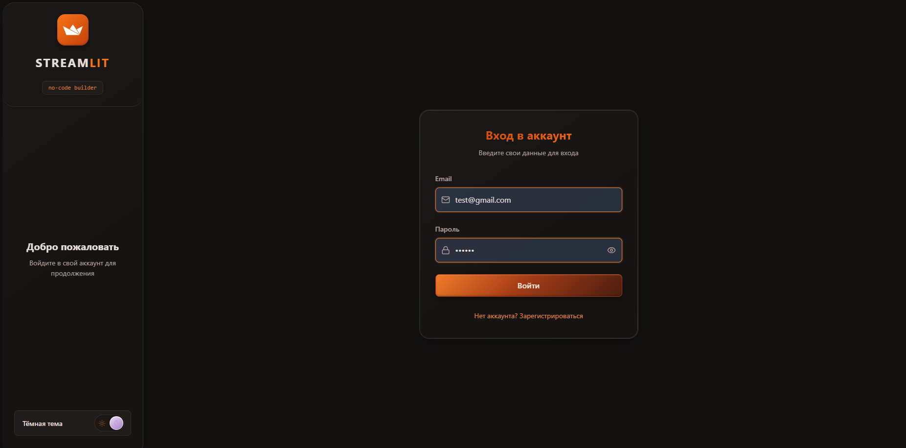
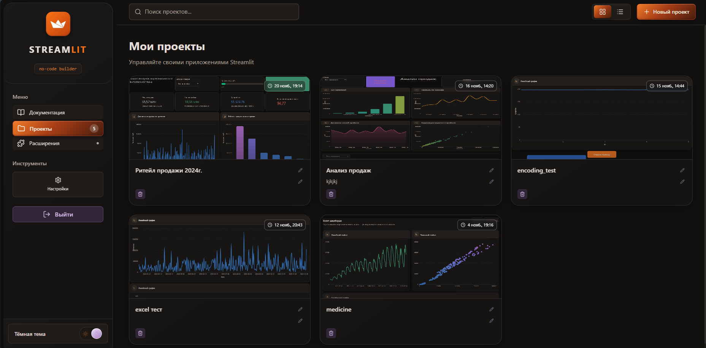
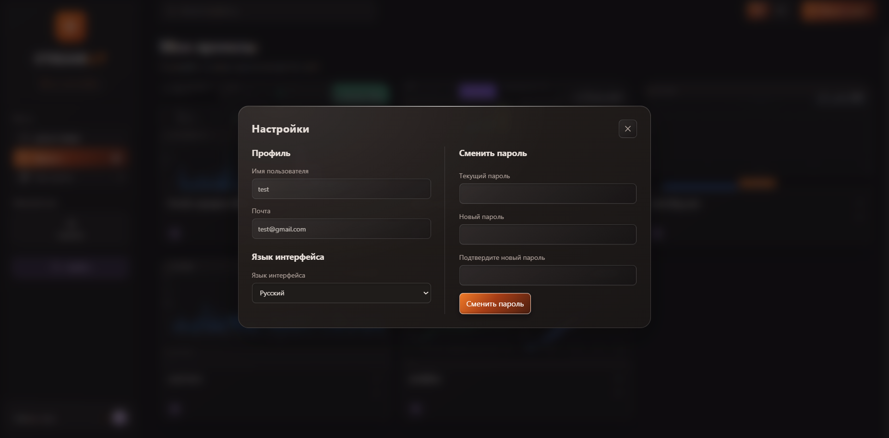
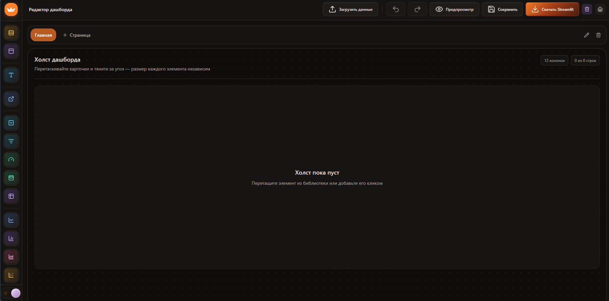
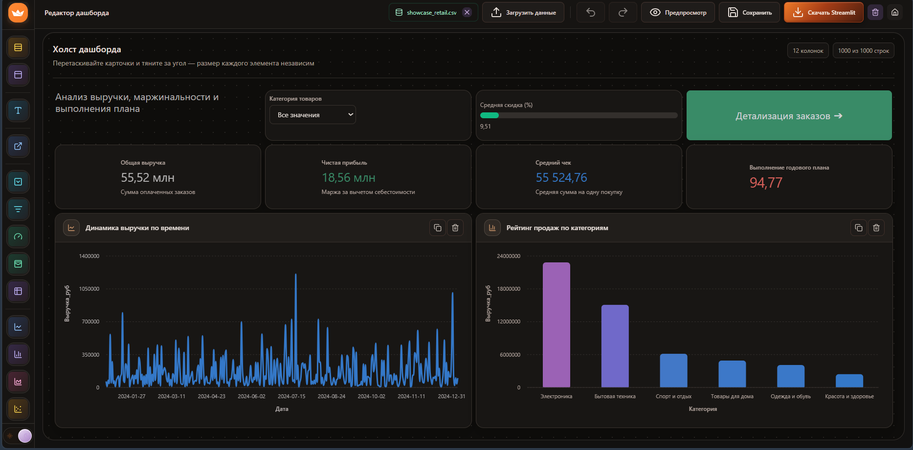
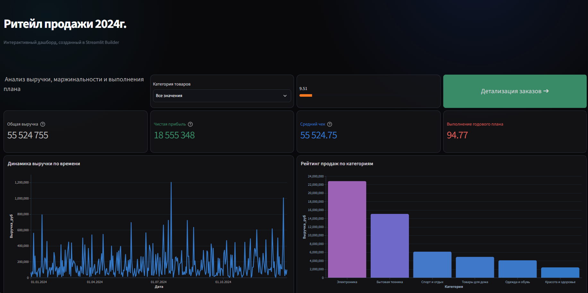

[English](README.md) | **Русский**

# Конструктор Streamlit-приложений (No-Code Dashboard Builder)


**Визуальный no-code конструктор для быстрого создания интерактивных дашбордов на базе Python и Streamlit.**

**Пользовательский сценарий:** загрузите таблицу с данными (`CSV`, `TSV` или `Excel`), расставьте графики, KPI-метрики, таблицы и фильтры на холсте перетаскиванием — и получите готовое веб-приложение без написания кода. Инструмент подойдёт аналитикам, продакт-менеджерам и разработчикам, которым нужно быстро собрать рабочий прототип или полноценный дашборд без долгой ручной вёрстки.

### Как это работает и что вы получаете
1. **Загрузка данных:** загружайте один или несколько источников данных и сразу используйте их колонки на холсте.
2. **Быстрая сборка на холсте:** перетаскивайте компоненты на 12-колоночную сетку, настраивайте цвета, агрегации и многостраничность. Графики на холсте сразу строятся в браузере с помощью сторонней веб-библиотеки **Recharts** — это даёт мгновенный отклик при настройке.
3. **Предпросмотр на Streamlit:** чтобы увидеть, как именно будет выглядеть итоговое приложение и его сгенерированный код на самом движке **Streamlit**, запустите предпросмотр — дашборд откроется во встроенном окне или в новой вкладке ещё до скачивания.
4. **Экспорт исходного кода в 1 клик:** скачайте готовый ZIP-архив (`app.py`, датасеты, `requirements.txt` и скрипты запуска). Вы не привязаны к платформе — код можно сразу развернуть на любом сервере или доработать вручную на Python.

> **О репозитории:** здесь находится веб-редактор (Frontend на React) и файл [`docker-compose.yml`](docker-compose.yml) для быстрого запуска всей платформы целиком. Серверная часть (API, хранение проектов, запуск предпросмотра на Streamlit и генератор Python-кода) вынесена в репозиторий [`streamlit_project_backend`](https://github.com/AlexFeed/streamlit_project_backend).

---

## Позиционирование

Этот проект **не является прямым конкурентом корпоративным BI-системам** вроде Apache Superset, Yandex DataLens, Metabase или Power BI. У него другая задача — **быстрое создание автономных дашбордов на Python и Streamlit с полной свободой дальнейшего использования**.

* **Никакой привязки к платформе и серверам (no vendor lock-in):** в классических BI-системах дашборд «живёт» только внутри самой платформы — его нельзя забрать с собой без этого BI-сервера. Здесь конструктор нужен только на этапе сборки: готовый проект полностью независим от нашего сервиса.
* **Результат — обычный Python-код:** на выходе вы получаете не проприетарную конфигурацию, а понятный код на Streamlit (`app.py`), список зависимостей (`requirements.txt`) и ваши данные.
* **Свобода доработки и интеграции:** скачанный дашборд можно сразу запустить на любом компьютере или сервере, положить в Git, расширить произвольной логикой на Python (например, подключить ML-модель, свой парсер или API) либо встроить как отдельную страницу/модуль в любое уже существующее Python- или Streamlit-приложение.
* **Быстрый старт без сложной инфраструктуры:** не нужно поднимать, настраивать и администрировать тяжёлый BI-стек ради одного аналитического отчёта, прототипа или внутреннего инструмента команды.

---

## Интерфейс платформы

### Вход и управление проектами

*Страница входа и регистрации.*


*Главная страница со списком сохранённых проектов.*


*Страница настроек приложения.*

### Конструктор и предпросмотр

*Пустой проект в редакторе: палитра компонентов слева, 12-колоночная сетка в центре и панель настроек справа.*


*Собранный дашборд в конструкторе с настроенными графиками и фильтрами (предпросмотр графиков через библиотеку Recharts).*


*То же самое приложение, запущенное на движке Streamlit через окно предпросмотра.*

---

## Запуск приложения

### Вариант 1. Запуск через Docker

Этот способ поднимает сразу всю платформу (веб-редактор, сервер и встроенный предпросмотр на Streamlit) — скачивать исходный код, устанавливать Python или Node.js самостоятельно не нужно. Достаточно одного файла [`docker-compose.yml`](docker-compose.yml): Docker сам загрузит готовые образы и запустит все сервисы.

**Требования:** установленный [Docker Desktop](https://www.docker.com/products/docker-desktop/) (или Docker Engine + Docker Compose) и свободные порты `5173`, `8000` и `8501`.

1. Создайте папку для запуска и скачайте в неё файл [`docker-compose.yml`](docker-compose.yml) (вручную через кнопку *Download raw file* на GitHub или командой в терминале):
   * **Linux / macOS / Git Bash:**
     ```bash
     mkdir streamlit-builder && cd streamlit-builder
     curl -fsSLO https://raw.githubusercontent.com/AlexFeed/streamlit_project/main/docker-compose.yml
     ```
   * **Windows (PowerShell):**
     ```powershell
     mkdir streamlit-builder; cd streamlit-builder
     Invoke-WebRequest -Uri https://raw.githubusercontent.com/AlexFeed/streamlit_project/main/docker-compose.yml -OutFile docker-compose.yml
     ```
2. В папке с `docker-compose.yml` запустите платформу в фоновом режиме (при первом запуске Docker скачает образы и поднимет сервисы — это может занять 1–2 минуты):
   ```bash
   docker compose up -d
   ```
3. Откройте конструктор в браузере:
   * **Веб-редактор:** http://localhost:5173

**Первый запуск в браузере:** на экране входа зарегистрируйте новый локальный аккаунт — аккаунты, проекты и загруженные файлы сохраняются локально в Docker volume `streamlit_storage`. После входа создайте проект и загрузите свой файл `CSV`, `TSV` или `Excel`.

<details>
<summary>Управление контейнерами (остановка, обновление, логи)</summary>

* **Остановить контейнеры** *(ваши аккаунты, проекты и датасеты сохраняются в `streamlit_storage`)*:
  ```bash
  docker compose down
  ```
* **Обновиться до актуальной версии образов:**
  ```bash
  docker compose pull && docker compose up -d
  ```
* **Посмотреть логи работы:**
  ```bash
  docker compose logs -f
  ```
* **Удалить контейнеры вместе со всеми локальными данными:**
  ```bash
  docker compose down -v
  ```

</details>

---

### Вариант 2. Локальный запуск из исходников (для разработки)

Подходит для разработчиков, которые хотят запускать и дорабатывать веб-интерфейс локально.

> **Важно:** фронтенд отвечает только за визуальный интерфейс. Для авторизации, загрузки файлов, сохранения проектов, предпросмотра на Streamlit и генерации ZIP-архива **необходимо параллельно запустить backend-сервер** из репозитория [`streamlit_project_backend`](https://github.com/AlexFeed/streamlit_project_backend) (инструкция по его установке и запуску находится в его `README.md`).

**Требования:** Node.js 20+ и запущенный backend-сервер.

1. Клонируйте репозиторий и перейдите в папку проекта:
   ```bash
   git clone https://github.com/AlexFeed/streamlit_project.git
   cd streamlit_project
   ```
2. Установите зависимости:
   ```bash
   npm install
   ```
3. Запустите dev-сервер:
   ```bash
   npm run dev
   ```

По умолчанию редактор будет доступен по адресу http://localhost:5173 и будет обращаться к API на `http://localhost:8000`. Если ваш бэкенд запущен на другом адресе или порту, задайте переменную окружения `VITE_API_BASE_URL` перед запуском:
* **Linux / macOS / Git Bash:**
  ```bash
  VITE_API_BASE_URL=http://localhost:8000 npm run dev
  ```
* **Windows (PowerShell):**
  ```powershell
  $env:VITE_API_BASE_URL="http://localhost:8000"; npm run dev
  ```

---

## Возможности текущей версии

### Визуальный редактор и компоновка
* **12-колоночный холст:** перетаскивайте элементы из палитры мышкой или добавляйте по клику, свободно меняйте ширину и высоту карточек, дублируйте элементы и используйте историю изменений (**Undo / Redo**).
* **Многостраничные дашборды:** создавайте несколько страниц внутри одного проекта, переключайтесь между ними в верхней панели редактора и настраивайте кнопки или текстовые ссылки для перехода между страницами.
* **Секции и вкладки:** группируйте компоненты в контейнеры («Секция») с настройкой отступов, фона, границ и выравнивания или размещайте несколько областей контента внутри компонента «Вкладки» на одной странице.
* **Быстрая отрисовка на холсте (через Recharts):** во время редактирования графики, таблицы и метрики сразу строятся прямо в браузере с помощью сторонней библиотеки **Recharts** (на выборке до 1000 строк — для высокой скорости отклика). Это удобный визуальный черновик для настройки полей и компоновки: его оформление может немного отличаться от итогового вида в Streamlit.

### Поддерживаемые графики, элементы и фильтры
* **Графики:** линейный (`Line Chart`), столбчатый (`Bar Chart`), с областями (`Area Chart`), точечный (`Scatter Plot`). Поддерживаются агрегации (`sum`, `mean`, `count`, `min`, `max`, без агрегации), сортировка по осям X/Y, готовые цветовые палитры (один цвет, градиент по значению, категориальная раскраска) и настройка подписей осей.
* **Данные и показатели:** карточки KPI-метрик, индикаторы прогресса (с заданием минимума и максимума), а также **таблицы** — обычная таблица с выбором нужных столбцов и лимитом строк (до 10 000) или **сводная таблица (Pivot)** с группировкой и расчётом значений.
* **Интерактивные фильтры:**
  * Фильтр по категориям и значениям (выпадающий список, множественный выбор, радиокнопки, сегменты, кнопки-теги).
  * Элементы управления данными (числовой диапазон, выбор даты, переключатель).
* **Оформление и навигация:** текстовые блоки с настройкой размера, начертания, цвета и выравнивания, а также элементы перехода на другие страницы.

### Работа с источниками данных
* **Поддерживаемые форматы:** `CSV`, `TSV` и `Excel` (`.xlsx`, `.xls`).
* **Гибкий импорт:** выбор разделителя колонок (или автоопределение) и поддержка **24 кодировок** (`UTF-8`, `UTF-8 с BOM`, `Windows-1251`, `CP866`, `KOI8-R` и др.) с автоопределением.
* **Удобная работа с Excel:** при загрузке книги редактор считывает список доступных листов и позволяет выбрать нужный до импорта.
* **Несколько датасетов в одном проекте:** можно загрузить несколько разных таблиц и привязать каждый график, таблицу или фильтр к своему источнику.

### Предпросмотр, экспорт и рабочее пространство
* **Предпросмотр реального Streamlit-приложения:** чтобы проверить, как дашборд будет выглядеть и работать именно через **Streamlit** (по сгенерированному Python-коду и на всём загруженном датасете), нажмите кнопку **«Предпросмотр»** — приложение запустится прямо во встроенном окне редактора или в отдельной вкладке браузера без скачивания архива.
* **Скачивание готового проекта:** экспорт ZIP-архива со сгенерированным `app.py`, вашими датасетами, `requirements.txt` и готовыми скриптами локального запуска (`run_local.bat` / `run_local.sh`; для запуска скачанного проекта локально потребуется установленный Python).
* **Личный кабинет и интерфейс:** регистрация и вход в аккаунт, галерея проектов с превью-карточками, автосохранение черновиков, переключение светлой/тёмной темы и поддержка русского и английского языков (**RU / EN**).

---

## Текущие ограничения (MVP) и планы развития

Проект находится в стадии MVP и рассчитан в первую очередь на локальное использование, прототипирование и работу небольших команд.

### Текущие ограничения
* **Файловое хранилище:** аккаунты, проекты и загруженные файлы хранятся на диске сервера (в Docker volume `streamlit_storage`) без внешней базы данных и объектного хранилища.
* **Нет командного доступа и расширенной авторизации:** проекты привязаны к конкретному аккаунту — пока нет совместного редактирования, ролевой модели (RBAC), `refresh_token` и функции сброса пароля.
* **Один источник данных на компонент:** в проект можно загрузить несколько таблиц, но объединять их между собой (`JOIN`) или подключаться напрямую к внешним БД и API в интерфейсе пока нельзя.
* **Базовый набор визуализаций и прототип расширений:** отсутствуют круговые диаграммы (`Pie Chart`) и настройка собственных тем оформления итогового Streamlit-приложения; раздел «Расширения» в интерфейсе сейчас носит демонстрационный характер и не подключает сторонние библиотеки в экспортируемый код.
* **Общий процесс для предпросмотра на Streamlit:** предпросмотр работает на одном фоновом процессе Streamlit, что подходит для личной работы или небольшой команды, но не рассчитано на высокую конкурентную нагрузку.

### Планы развития (Roadmap)
* **Расширенная поддержка графиков и интерактивных элементов Streamlit:** добавление новых видов диаграмм (например, круговых) и дополнительных виджетов из библиотеки Streamlit.
* **Более гибкая настройка графиков:** расширение свойств и параметров конкретных графиков (дополнительные настройки осей, легенд, подписей значений и оформления).
* **Встроенный мини-редактор кода перед экспортом:** возможность просматривать и редактировать сгенерированный Python-код (`app.py`) прямо в окне приложения до скачивания проекта.
* **Полноценная поддержка расширений:** превращение раздела **«Расширения»** в рабочую систему плагинов с сохранением на сервере и реальным подключением выбранных библиотек (графиков, карт, кастомных компонентов) в редактор и экспортируемый `app.py` (сейчас страница расширений работает как статическое демо интерфейса).
* **Новые источники и объединение данных:** подключение к внешним БД/API и объединение нескольких датасетов (`JOIN`) внутри дашборда.
* **Темы и публикация:** настройка тем оформления экспортируемого приложения и прямой экспорт или публикация дашборда в Git-репозиторий.

---

## Технологический стек и документация

* **Frontend:** React 19, Vite 8, React Router v7, GridStack, @dnd-kit, Recharts, Tailwind CSS, Nginx (в Docker-образе).
* **Backend и генерация кода:** FastAPI, Pydantic v2, Pandas, Streamlit.
* **Сборка frontend для production:** `npm run build`
* **Подробное описание серверной архитектуры, REST API и контракта схемы:** см. репозиторий [`streamlit_project_backend`](https://github.com/AlexFeed/streamlit_project_backend).

---

## Лицензия

Copyright © 2026 Авторы и контрибьюторы проекта ([Contributors](https://github.com/AlexFeed/streamlit_project/graphs/contributors))

Исходный код конструктора распространяется под лицензией **GNU Affero General Public License v3.0 (`AGPL-3.0-only`)** — полный текст приведён в файле [`LICENSE`](LICENSE).

* **Для пользователей конструктора:** вы можете бесплатно использовать, запускать, копировать и дорабатывать платформу, в том числе внутри компаний и для создания коммерческих дашбордов. Если вы модифицируете сам конструктор и распространяете его или предоставляете к нему доступ по сети (например, как веб-сервис), ваша версия также должна быть открыта под лицензией `GNU AGPLv3` с сохранением указания авторства.
* **Исключение для сгенерированных дашбордов (Additional Permission, Section 7 AGPLv3):** условия `GNU AGPLv3` относятся **только к коду самого конструктора**. Экспортируемые дашборды (`app.py` и содержимое скачиваемого ZIP-архива) **не подпадают** под копилефт-требования `AGPLv3` — вы можете свободно запускать, изменять, продавать и встраивать их в любые (в том числе закрытые и коммерческие) Python- и Streamlit-проекты без необходимости открывать свой код.
